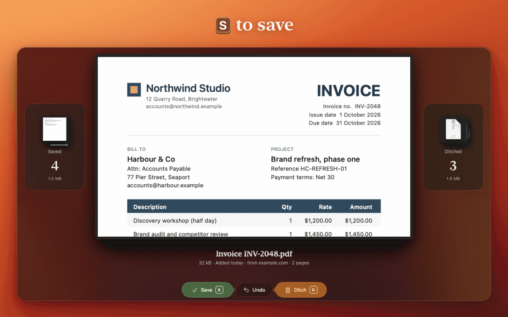
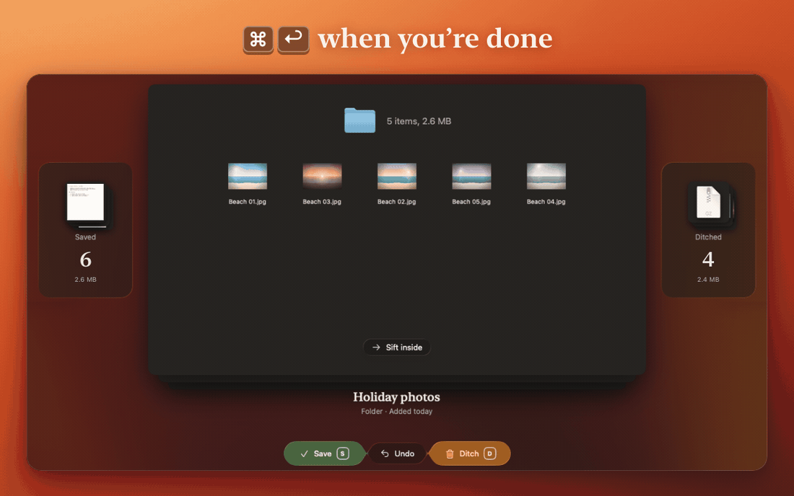

<p align="center">
  
</p>

<h1 align="center">Sift</h1>

<p align="center">
  <b>Clear out a messy folder one file at a time.</b><br>
  See a real preview of everything, press <kbd>S</kbd> to save or <kbd>D</kbd> to ditch, and nothing leaves until you say so.
</p>

<p align="center">
  
  
  <a href="LICENSE"></a></p>

<p align="center">
  <a href="#install"><b>Install</b></a>
  &nbsp;&middot;&nbsp;
  <a href="#quick-start"><b>Quick start</b></a>
  &nbsp;&middot;&nbsp;
  <a href="#keys"><b>Keys</b></a>
  &nbsp;&middot;&nbsp;
  <a href="#privacy"><b>Privacy</b></a>
</p>

<p align="center">
  <picture>
    <source media="(prefers-reduced-motion: reduce)" srcset="docs/sifting.png">
    
  </picture>
</p>

Photo apps have had swipe-to-clean for years. Sift brings it to the rest of your Mac: point it at Downloads, your Desktop or any folder, and work through it the way you would a stack of paper. Each file shows a live Quick Look preview between a Saved pile and a Ditched pile. When you finish, you check the list once, and ditched files go to the Bin, where you can still put them back.

It is a native macOS 26 app, written in SwiftUI with Liquid Glass.

## Install

Sift is built from source for now, so there is no download yet. You need macOS 26, Xcode 26 and [XcodeGen](https://github.com/yonaskolb/XcodeGen).

```bash
brew install xcodegen
git clone https://github.com/rightin2/sift.git
cd sift
scripts/install.sh
```

The script builds a Release copy and installs it in `/Applications`. To update, run `git pull` and `scripts/install.sh` again.

To remove Sift, turn off **Open Sift at login** in its settings if you turned it on, move Sift from Applications to the Bin, and delete `~/Library/Application Support/Sift`, where it remembers past sifts.

<details>
<summary><b>Working on Sift</b></summary>

Run `xcodegen generate` and open `Sift.xcodeproj`. The engine (scanning, decisions, undo, memory and the Bin) is a separate Swift package with its own tests:

```bash
cd SiftCore && swift test
```

</details>

## Quick start

1. Open Sift and pick Downloads or Desktop, press **Choose a folder** for any other, or drop a folder on the window.
2. Press **S** to save or **D** to ditch each file. **E** or Space looks closer, and ⌘Z undoes.
3. Press ⌘↩ when you are done. Check the list once, and ditched files go to the Bin, where you can still put them back.

## How it works

### Step into folders

A Finder-style column view shows where you are. Press <kbd>→</kbd> to sift inside a folder and <kbd>←</kbd> to come back up; each folder keeps its own decisions.

<p align="center">
  <picture>
    <source media="(prefers-reduced-motion: reduce)" srcset="docs/folder.png">
    
  </picture>
</p>

### Nothing moves until you confirm

Press <kbd>⌘</kbd><kbd>↩</kbd> when you are done. Sift lists everything that will go to the Bin, by folder, and moves nothing until you confirm. The Done screen shows the space you freed, and <b>Review ditched</b> puts back anything you still need.

<p align="center">
  <picture>
    <source media="(prefers-reduced-motion: reduce)" srcset="docs/confirm.png">
    
  </picture>
</p>

## What it does

- **Real previews of everything.** Images, PDFs, documents, spreadsheets, audio and video preview live in the card. Folders show what's inside, archives and apps show their contents without unpacking, and anything Quick Look can't draw gets a card with the site it was downloaded from.
- **The facts that make a decision quick.** Size, when it arrived, where it came from, whether you ever opened it, and its dimensions, page count or length. Chips appear only when they matter: an identical copy in the folder, an archive already unzipped beside it, a download still in progress, locked, in iCloud or tagged.
- **Finder-style folders.** A column view shows where you are. Press → to sift inside a folder and ← to come back; each folder keeps its own decisions.
- **Remembers between sifts.** Open the same folder next week and you start at what's new. Files that arrive while you sift join the end of the queue.
- **Safe by design.** Nothing moves until you confirm. Every file is checked against what you saw before it moves, a ditched folder holding files you saved is flagged, and everything goes to the Bin, never a hard delete. The Done screen can put it all back.
- **Optional reminders.** Sift can watch Downloads from the menu bar and nudge you when ten or more files arrive in a day.

## Screenshots

<table>
  <tr>
    <td width="50%"></td>
    <td width="50%"></td>
  </tr>
  <tr>
    <td align="center"><sub>A live preview between the two piles</sub></td>
    <td align="center"><sub>Folders show what's inside</sub></td>
  </tr>
  <tr>
    <td width="50%"></td>
    <td width="50%"></td>
  </tr>
  <tr>
    <td align="center"><sub>Archives open without unpacking</sub></td>
    <td align="center"><sub>Find by name, and where a file came from</sub></td>
  </tr>
  <tr>
    <td width="50%"></td>
    <td width="50%"></td>
  </tr>
  <tr>
    <td align="center"><sub>One check before anything moves</sub></td>
    <td align="center"><sub>Space freed, and a way back</sub></td>
  </tr>
</table>

All screenshots are dark mode with the window's transparency turned up; Sift follows your Mac's light or dark setting.

## Keys

Left hand decides, right hand moves. Every key is also in the Sifting menu.

| Key | Does |
|---|---|
| <kbd>S</kbd>, or swipe left | Save |
| <kbd>D</kbd>, or swipe right | Ditch |
| <kbd>⌥S</kbd> / <kbd>⌥D</kbd> | Save or ditch everything left in this folder (ditch asks first) |
| <kbd>E</kbd> or <kbd>Space</kbd> | Look closer: Quick Look, or the contents of an archive or app |
| <kbd>↑</kbd> <kbd>↓</kbd> | Move without deciding |
| <kbd>→</kbd> / <kbd>←</kbd> | Sift inside a folder / go back up |
| <kbd>N</kbd> / <kbd>⇧N</kbd> | Next or previous undecided file |
| <kbd>⌘F</kbd>, <kbd>⌘G</kbd> | Find by name, find next |
| <kbd>⌘Z</kbd> | Undo, in whichever folder it happened |
| <kbd>⌘↩</kbd> | Finish and review what goes to the Bin |

## Privacy

Sift never connects to the internet and has no analytics. It reads only the folders you open, plus the one you choose to watch for reminders. Decisions are remembered in a small file in `~/Library/Application Support/Sift`.

## Thanks

Inspired by swipe-to-clean photo apps, and by DClutter and FileSwipe, two small open-source takes on the same idea.

## Licence

MIT. See [LICENSE](LICENSE).
